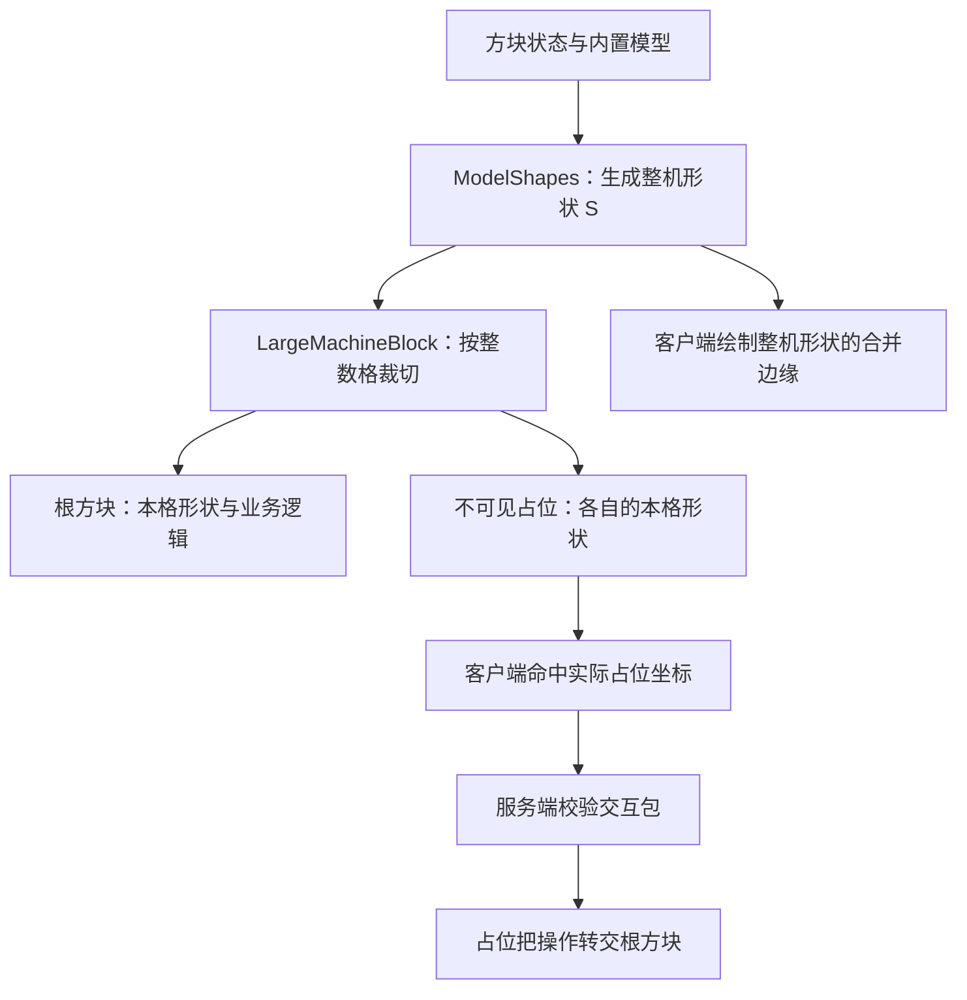

# 方块碰撞、占位与描边维护说明

本文记录当前 1.20.1 Fabric / Yarn 实现，供阅读代码、添加方块和后续重构时使用。核对日期：2026-11-18。

这套实现有两个相互独立的任务：生成适合玩家交互的形状；把跨格形状拆到实际占用的方块格中。模型精度、碰撞精度和选中描边因此分别处理。

建议先读第 1、2 节建立整体认识，再读第 3、4 节对照碰撞 Profile。新增方块时看第 7 节，维护测试时看第 8 节。

## 1. 为什么需要根方块和占位方块

一台机器仍然只有一个负责业务逻辑的根方块。库存、能量、GUI、配方和方块实体保留在根方块上；模型超过一格的部分由不可见的占位方块提供碰撞、射线命中和交互入口。

原先把超大 `VoxelShape` 全部返回给根方块，会出现两个问题：引擎的空间查询不一定按预期处理跨越多格的形状；玩家命中远处模型时，交互包仍指向根坐标，命中位置可能被服务端判定为离该坐标过远。单纯画出正确的选中框不能解决这两个问题。

当前流程如下：



以方块为单位，设整机形状为 `S`，占位相对根方块的整数偏移为 `d`，该格的局部形状为：

```text
part(d) = (S 平移 -d) ∩ [0, 1]³
占位的世界坐标 = 根坐标 + d
根坐标 = 占位坐标 - d
```

例如整机的一部分位于根方块右边第二格，它属于偏移 `(2, 0, 0)`。裁切后返回给那一格的坐标仍必须全部落在 `0..1` 中。`getMachineShape()` 可以超过这个范围，真正返回给单个方块的 `getCollisionShape()` 和 `getOutlineShape()` 则只负责本格。

不要直接把整机形状重新返回给根方块的碰撞查询，也不要为了远端交互放宽服务端的包校验。

## 2. 代码职责与阅读入口

以下路径均相对项目根目录；类名链接可直接打开对应文件。

| 文件 | 负责什么 | 阅读重点 |
| --- | --- | --- |
| [ModelShapes] | 读取模型、应用姿态与旋转并生成碰撞 | `bakeVanillaState`、`bakeGeoState`、`rasterize` |
| [ShapeProfile] | 描述形状来源和简化规则；由方块声明并复用 | `vanilla()`、`geo()`、`fixed()`、`horizontal()`、`byState()` |
| [LargeMachineBlock] | 裁切形状、检查放置、登记和维护占位 | `getPartShapes`、`canPlaceMachine`、`updateParts`、`registerParts` |
| [LargeMachinePartBlock] | 保存根坐标偏移，转发交互、挖掘和掉落 | `stateFor`、`findMachine`、`onUse`、`onBreak`、`afterBreak` |
| [LargeMachineOutlineRenderer] | 将占位命中还原为整机描边，缓存合并边缘 | `register`、`edges` |
| [JadePlugin] | 命中占位时让 Jade 查询根方块 | `redirectMachinePart` |
| [SterlingEngineBlock] | 炉子和发电机接口、飞轮与地板共存 | `occupiesCell`、`canSharePartCell`、`repairExposedFlywheel` |
| [FanBladeBlock] | 叶片背后支撑与安装轴的占格例外 | `getPlacementState`、`occupiesCell`、`canPlaceAt` |
| [FaradayGeneratorBlock] | 给引擎轴端留出连接格 | `occupiesCell` |
| [TrawlerBlock] | 水上放置，允许占位保留水源 | `allowsWaterParts`、`canPlaceAt` |
| [ModBlocks] | 在 `registerModBlocks()` 中启动占位注册 | `LargeMachineBlock.registerParts()` |
| [ModernDelightClient] | 仅在客户端注册整机描边 | `LargeMachineOutlineRenderer.register()` |
| [CrowbarItem]、[HolderItem] | 工具自己先查询方块时，先把占位坐标解析成根坐标 | `resolveMachinePos` 调用 |
| [ModModelGenerator]、[ModBlockTagGenerator]、[LargeMachineTranslations] | 生成占位模型引用、工具标签和名称 | `getRegisteredParts`、`addToolTag`、`includeParts` |
| [ModBlockLootGenerator] | 根方块的正常掉落表 | 占位挖掘最终仍需要正确的根方块掉落 |
| [LargeMachineTests]、[ModelShapeTests] | 在真实服务端环境验证碰撞与操作 | 第 8 节列出覆盖范围 |

`LargeMachineBlock` 继承 `BlockWithEntity`，但名字中的“大型机器”并不限制用途。目前部分餐具、食物和普通模型方块也使用它，以处理把手、盖子等很小的跨格部分。方块继承它不意味着一定使用 GeckoLib 渲染。

## 3. 如何阅读 ModelShapes

### 3.1 从方块类查找形状来源

`LargeMachineBlock` 在构造时接收 Profile，`getMachineShape(state)` 把它传给 `ModelShapes.get(state, profile)`。没传 Profile 的机器和直接调用 `ModelShapes.get(state)` 的普通方块都使用默认原版模型规则。

| 形状来源 | 适用情况 |
| --- | --- |
| 默认原版模型 | 从 `blockstates/<注册名>.json` 找匹配的 `variants`，读取模型并应用变体的 `x/y` 旋转；找不到变体时读取 `models/block/<注册名>.json` |
| `ShapeProfile.vanilla()` | 仍跟随原版变体，可以过滤元素、按选中的元素生成简化形状，或用手写形状替换模型并保留变体旋转 |
| `ShapeProfile.geo()` | 根据注册名读取 `geo/<注册名>.geo.json`，选择稳定姿态，再按水平朝向旋转；规则可过滤骨骼中的长方体、近似运动范围、补形状 |
| `fixed` / `horizontal` / `byState` | 分别返回固定形状、按水平朝向旋转北向形状，或从方块状态计算形状；这些规则不读取模型 |

木盘、炸鱼薯条和英式早餐直接在方块类定义固定长方体，模型高度分别为 1、2、3 像素。烤炉和高级熔炉使用原版整格碰撞。

### 3.2 缓存如何复用形状

| 缓存 | 键 | 值 |
| --- | --- | --- |
| `ShapeProfile.states` | 当前 Profile 内的 `BlockState` | 该状态最终使用的形状 |
| `ModelCache` 中的模型缓存 | 当前 Profile 内的原版模型路径，或 GEO 名称和稳定姿态 | 应用方块朝向之前的形状 |
| `ModelCache.rotated` | 当前 Profile 内的原形状、X/Y 旋转角 | 旋转后的形状 |
| `ModelShapes.JSON` | 相对资源路径 | 解析后的 JSON 对象 |

不同 Profile 可以读同一份 JSON，各自生成并保存碰撞。同一 Profile 下，几何等价的模型状态可以复用形状，例如工作标志改变但姿态和朝向相同的 GEO 状态。将 Profile 声明为 `static final`，并让姿态条件读取确定的方块状态。不要依赖调用时的世界或动画进度：这里的结果会被缓存，`LargeMachineBlock` 也会按形状复用各格裁切结果。

注册占位时会遍历机器的所有状态，所以很多模型只在初始化时生成一次。资源从内置的 `/assets/moderndelight/` 读取，没有随客户端资源包重载；改资源或规则后应重启开发实例验证。

### 3.3 坐标、旋转与栅格化

| 层次 | 坐标单位 | 原点与范围 |
| --- | --- | --- |
| 模型 JSON、`box(...)`、`Cube` | 模型像素 | 常规方块边长为 16，允许超出 `0..16` |
| `VoxelShape` | 方块 | 同一尺寸除以 16；整机形状可超出 `0..1` |
| `BlockPos` 偏移 | 整数格 | 相对根方块的位置，不是像素 |

`box(2, 0, 2, 14, 17, 14)` 调用 `Block.createCuboidShape`，参数仍是模型像素。它高 17 像素，确实会进入上方一格，不是写错单位。

原版模型分支读取 `from/to`，支持单个元素的轴旋转、旋转中心和 `rescale`。GEO 分支则需要把模型坐标转换到方块坐标：

- X 方向镜像，长方体范围从 `origin/size` 转为 `[-origin.x-size.x, -origin.x]`，并计入 `inflate`。
- 根部补上 `(8, 0, 8)` 模型像素的平移。
- `geoRotation()` 围绕 pivot 构造旋转矩阵，代码顺序为 Z、Y、X，其中 X/Y 角度取负，Z 保留正号。
- `boneTransform()` 沿父骨骼递归组合变换；方块水平朝向再由 `orient()` 处理。

这里的正负号和矩阵组合是在匹配现有 GEO 渲染坐标。不要只凭模型编辑器里的角度直觉修改；应同时验证四个朝向和至少一个非对称部件。

`Cube.min/max` 表示变换前的长方体，`matrix` 是变换，`lower/upper` 是将八个顶点变换后的轴对齐包围范围。`bounds(cubes)` 会丢弃内部细节，只保留所有范围的总包围盒。

`rasterize()` 的过程是：求总范围，建立 `BitSetVoxelSet`，遍历各长方体附近的网格，使用逆矩阵把网格中心变回模型局部坐标，判断占用，再转为 `ArrayVoxelShape` 并调用 `simplify()`。边缘容差用于减小旋转薄片漏采样及浮点边界误差，不是精确多边形求交。

`STEP = 0.5f` 表示网格边长为半个模型像素，即 `1/32` 格。减小它会同时增加三个方向上的网格数量。`simplify()` 能合并部分体素，但不能保证复杂旋转模型最终只有少量长方体。

### 3.4 当前加载器的边界

这不是完整的 Minecraft 模型烘焙器或 GeckoLib 动画解释器：

- 变体数组只取第一个模型，不按权重组合随机外形。
- 没有实现 `multipart` 形状合成，也没有处理 `a|b` 这类属性值条件。
- 模型无 `elements` 时，只会递归跟随 `moderndelight:` 父模型；没有完整解析跨命名空间继承和父子元素合并。
- GEO 只读取首个 `minecraft:geometry`，骨骼变换和动画数据格式按现有模型需要实现。
- `sample()` 对支持的向量关键帧作线性插值，没有实现完整动画表达式、事件或所有插值方式。
- 缺失模型不会自动安全地退化成满方块：部分读取会抛异常，需要修复资源或提供明确的简化规则。

添加新类型模型时，应先确认是否在这些支持范围内。

## 4. 修改碰撞规则的位置

### 4.1 容器、食物和网状结构

以下尺寸均为模型像素。调整规则时，先打开对应方块类的 `COLLISION_PROFILE`。

| 方块类 | 当前规则 |
| --- | --- |
| `ClayPotBlock` / `ClayPotFoodBlock` | 简化为锅底、两段锅身和横向把手；菜品基类直接传入空锅 Profile，不读取食材模型 |
| `BambooGrateBlock` | X/Z 为 `1..15`；每层和盖子各贡献 4 像素高度；网孔填实 |
| `ElectricSteamerBlock` | `(2,0,2)..(14,17,14)`，工作状态共用；顶部仍越一格 |
| `DeepFryBasketBlock` | `(-12,0,1)..(16,9,15)`，含网篮与手柄；使用 blockstate 的旋转 |
| `GlassCupBlock` / `GlassCupOfTeaBlock` | 从每个杯模型里找底面 Y=1、尺寸为 `(1,2,1)` 的细柄定位；填实杯腔，保留杯间空隙；茶复用单杯形状 |
| `JuiceExtractorBlock` | 两段底座、实心杯体及出汁口；使用北向手写形状旋转 |
| `TrawlerBlock` | 按升降姿态算总包围盒；下放时将非 `body` 骨骼下移 21 像素，不生成网孔 |

木盆和玻璃碗仍保留空腔。验证杯子时，应检查杯腔、细柄、杯间空隙和盒子总量；`simplify()` 可能改变盒子的分解方式。

### 4.2 机器的骨骼与简化尺寸

| 方块类 | 当前规则 |
| --- | --- |
| `IndustrialFermenterBlock` | 读取 `cap` 骨骼，以盖子 pivot 为中心在开盖状态绕 X 轴转 `-80°`；罐体与侧架使用实心长方体；把变换后的盖子块各自简化成轴对齐包围盒 |
| `IceCreamMakerBlock` | 忽略展示食物的 `cup` 和 `cream` 骨骼 |
| `FanBladeBlock` | 跳过 `bone`，保留轴；在 X/Y 平面以 `(8,8.5)` 为圆心补半径 34 的叶片圆盘和半径 5 的轮毂 |
| `SterlingEngineBlock` | 过滤嵌入炉子的加热套和部分飞轮细节；对 `idle` 的 0 到 0.5 秒分 32 段采样，为每个选中的运动骨骼生成一个包围盒；在 Y/Z 平面以 `(-5,-40)` 为圆心补完整的半径 22 飞轮，X 厚度为 `17..20` |
| `WindTurbineControllerBlock` | 过滤原版模型中 `from.z >= 16` 的装饰接头，留出线圈安装格 |

`addDiskInXY()` 和 `addDiskInYZ()` 的最后两个参数分别指定 Z 和 X 方向的厚度边界。通用圆盘工具按 4 像素分带，使用每条带内最靠近圆心的位置计算宽度，因此形状会略向外覆盖。它和栅格化用的半像素步长是两件事。

### 4.3 连接与地板规则属于方块逻辑

只简化形状不能处理所有安装关系。几个占格例外位于各方块类：

| 对象 | 规则 |
| --- | --- |
| 叶片 | `occupiesCell` 排除背后支撑格；`canPlaceAt` 要求背后有非占位支撑；失去背后支撑时脱落 |
| 引擎 | 排除支撑炉子 `(0,-1,0)`，以及北向时法拉第发电机接口 `(-1,-1,-3)`；接口偏移随朝向旋转 |
| 法拉第发电机 | 排除自身背后的接头格，让出引擎轴端位置 |
| 引擎下半飞轮 | 对 `offset.y<-1` 的格子，允许保留已经完全覆盖该格飞轮形状的无流体实体碰撞；不借用其他机器的占位 |

最后一条由 `canSharePartCell()` 实现。它检查“飞轮局部形状减去现有方块碰撞是否为空”，而不只是检查现有方块是否不透明。实体地板可以提供同一位置的碰撞；不能完全包住飞轮的栅栏等障碍仍会阻止放置。

共享格不会被替换成占位，保留原地板。若下半飞轮悬空，就正常放置占位。`repairExposedFlywheel()` 在服务端每 20 tick 检查一次下方已加载格；发现地板被移除后变成空气，安排下一 tick 补上占位。它从引擎的方块实体 ticker 中调用，不要在重写 ticker 时遗漏。

完整轮盘仍用于整机描边；埋在地板里的部分由地板提供实体碰撞，点击那里命中的是地板。为兼容地板而再次把整机 Y 坐标裁到 `-16`，会重新出现飞轮缺少下半圈的问题。

## 5. 占位的注册与生命周期

### 5.1 注册、偏移编码和缓存约束

`registerParts()` 在根方块注册完成后遍历每种 `LargeMachineBlock` 的全部状态。只要有一个状态需要占用根格之外的方块格，就登记 `<根注册名>_part`。占位通过方块状态保存归属，注册时只创建方块。

占位通过方块状态保存朝向、`waterlogged` 和三个偏移。整数属性使用非负编码：

```text
普通占位：真实偏移 -2..2，保存为 0..4
Wide 占位：真实偏移 -4..4，保存为 0..8
保存值 = 真实偏移 + radius
```

超过两格的机器自动使用 `Wide`。当前最大范围为每个轴 ±4。外形超过这个范围时，需要一起调整偏移属性和测试。

`getPartShapes()` 按整机 `VoxelShape` 缓存裁切结果。`occupiesCell()` 当前在这一步参与裁切，因此如果未来让它依赖形状之外的新状态，要一起调整缓存键。尤其不要在 `occupiesCell()` 中加入随世界变化的判断；依赖世界的共享逻辑应放到 `canSharePartCell()`。

### 5.2 放置、变形与清理

| 时机 | 行为 |
| --- | --- |
| `getPlacementState` | 子类先确定朝向和初始状态，再调用 `canPlaceMachine`；既检查全部格子，也检查实体占用 |
| `onPlaced` | 服务端立即生成占位 |
| `onBlockAdded` | 安排延后一 tick 更新，兼容非普通物品放置路径 |
| 根状态切换 | 整机形状对象改变或水平朝向改变时，安排更新 |
| `updateParts` | 清理失效占位，再创建或更新属于当前形状的占位；遇到障碍或未加载区块时可延后重试 |
| 根方块移除 | 清理已加载且属于自己的占位，保留别的方块和机器 |
| 占位自己的定时更新 | 根已不存在或当前形状不再包含该格时自清理；根区块未加载则延后 |

更新时只填充可用且已加载的格子，等阻挡移除或区块加载后再重试。清理时只处理已加载且属于当前根的占位。

继承类重写 `onPlaced`、`onStateReplaced` 等方法时应继续调用 `super`。涉及炉子、水源或背后支撑的检查要考虑到“生成占位本身也会触发邻居更新”，不能把占位生成误判为支撑失效。

### 5.3 交互、工具和挖掘掉落

`LargeMachinePartBlock.onUse()` 在服务端包校验之后调用根状态的 `onUse()`，通过 `hit.withBlockPos(root)` 改写方块坐标；命中点仍是原来的世界坐标。若新交互需要根据点击位置判断具体面板，应明确把命中点转换到根方块坐标系。

`getPickStack()` 和挖掘速度查询转给根方块。普通挖掘通过 `onBreak` 暂存根状态与方块实体，根移除负责库存释放，`afterBreak` 把根实体交给根的掉落逻辑，以保留电池能量等信息。创造模式不会经过相同的 `afterBreak` 路径，代码对此另有清理。

不要同时让根和占位各掉落一台机器。也不要绕过根的 `afterBreak`，否则可能保留了物品名称，却丢失能量或其他数据。手持工具直接执行 `useOnBlock()` 并查询方块实体时，需要先调用 `resolveMachinePos()`，不能只依赖方块的 `onUse()` 转发；撬棍和夹取工具是现有参考。

根状态承担实际开盖、库存等动态信息；占位查询形状时读取根状态，因此不需要在每个占位上复制整台机器的全部属性。结构旋转、镜像则必须同时变换占位偏移和朝向，否则根坐标会算错。

Jade 在自己的射线回调里把有效占位的查询目标换成根坐标、根状态和根方块实体。这样客户端能选中根方块的提示组件，服务端也会按根坐标读取同一个详情提供器。实际准心命中点仍在占位上，游戏内交互走原来的转发流程。

### 5.4 水与光照

拖网允许占位替换静止水源，并用 `waterlogged` 保存水。清理时恢复该占位的流体方块，保证降网、收网和拆除不会抽掉水源。当前只接受静止水，不能把这个例外扩大成可覆盖任意流体。

占位的透明度、光照阻挡和面剔除查询不应为了读取形状而跨区块查根方块。`isTransparent()`、`getOpacity()`、`getCullingShape()` 已单独实现：空占位不阻光，含水时按水处理，剔除形状为空。这些查询可能由光照线程执行，回到 `ServerWorld.getBlockState()` 查询相邻根区块曾造成停滞；重构时必须保留不读取根的约束。

## 6. 描边为什么单独绘制

`LargeMachineOutlineRenderer` 注册 `WorldRenderEvents.BLOCK_OUTLINE`，对 `moderndelight` 方块接管描边。命中占位时先求根坐标；大型方块使用整机形状，其他模组方块使用自身的选中形状。

先前使用的 `WorldRenderer.drawShapeOutline()` 路径会分别描绘形状组成长方体的边，复杂模型上的内部接缝因此变成大量黑线。当前对完整形状调用 `shape.forEachEdge()`，提取合并后的边缘，再写入线条顶点。

提取结果用 `WeakHashMap<VoxelShape, List<Edge>>` 缓存，避免每帧重新遍历体素，也避免永久持有临时形状。线条绘制仍然有成本；缓存不会减少模型本身的面数，也不代表所有掉帧都能靠碰撞优化解决。

不要从每个占位分别绘制轮廓，否则机器跨整数格的位置会多出接缝。当前描边是碰撞形状的轮廓，而不是模型网格的精确轮廓，圆盘的简化台阶仍可能显示出来。

## 7. 新增方块或修改模型的操作路径

### 7.1 普通小型不规则方块

外形及所有变体都在本格内时，可以继续继承 `Block`，在 `getOutlineShape()` 和 `getCollisionShape()` 中返回 `ModelShapes.get(state)`。若形状需要动态边界，按现有接入类配置 `dynamicBounds()`。

先检查自动读取模型是否足够。食物、容器和网格优先用少量稳定长方体表达可操作区域；增加装饰模型细节不应自动增加同等精度的碰撞。

一旦把手、盖子或其他状态越格，就需要跨格占位方案；仅给普通 `Block` 返回越界形状不能获得这里的放置和交互修复。

### 7.2 新的大型机器

1. 使用 `LargeMachineBlock`，实现该方块原有渲染、方块实体和业务逻辑。
2. 确定形状来源：可直接读取原版 `variants` 时使用默认构造函数；GEO 或手写形状则在当前方块声明一个 Profile，传入 `super(..., COLLISION_PROFILE)`。
3. 为模型的特殊规则选择 builder 操作，或在类里写一个有名字的几何方法，用 `byState` / `simplifyElements` 调用它。砂锅菜品只需继承 `ClayPotFoodBlock`；基类已传入空锅的 Profile。
4. 在 `getPlacementState()` 中先确定初始状态和朝向，再调用 `canPlaceMachine()`。重写 `canPlaceAt()` 时保留父类全部占格检查。
5. 若有设计上的嵌入接口，用 `occupiesCell()` 留出确定的连接格；根据世界中实际碰撞允许共存时，才考虑 `canSharePartCell()`。
6. 确认所有状态的最大偏移都可编码，检查开门、堆叠、升降、朝向以及支撑移除。
7. 运行数据生成，检查 `_part` 方块状态、名称、工具标签和根方块掉落表。普通新增机器不需要手动登记占位物品。
8. 增加行为回归测试，然后在客户端检查描边、交互和动画观感。

例如，GEO 机器按注册名查找模型，并过滤一个只用于显示产品的骨骼：

```java
private static final ShapeProfile COLLISION_PROFILE = ShapeProfile.geo()
        .filterCubes((bone, origin) -> !bone.equals("product"))
        .build();

public ExampleMachineBlock() {
    super(COLLISION_PROFILE);
}
```

没有额外规则的 GEO 机器只需 `ShapeProfile.geo().build()`。普通单格方块可以在两个形状查询里调用 `ModelShapes.get(state, COLLISION_PROFILE)`；只有一个固定长方体时，可以直接定义并返回它。

所有占位 blockstate 统一由 `ModModelGenerator` 生成，并引用同一个空模型 `models/block/large_machine_part.json`。 [ModModelGenerator]

工具要求通过 [ModBlockTagGenerator] 的 `addToolTag()` 同时加到根与占位，翻译通过 [LargeMachineTranslations] 复制根名称。新增代码若绕过这些辅助方法，需自行保证两端一致。

### 7.3 修改已有模型前的检查表

| 改动 | 必须一起检查 |
| --- | --- |
| 改注册 ID | 随注册名解析的模型资源、重新生成的 `_part` 资源 |
| 改 GEO 骨骼名、父子关系或 pivot | 忽略骨骼、开盖变换、飞轮替代、动画采样 |
| 改外形尺寸 | 手写 `box`、圆盘中心/半径/厚度、占位编码范围 |
| 改动画周期、下放距离 | 本类 Profile 中的采样时长、下移距离和姿态条件 |
| 改默认朝向或模型基准朝向 | 原版 `variants` 旋转、GEO 的北向基准、接口偏移旋转 |
| 加状态或变体 | Profile 姿态选择和全部状态的占位注册 |
| 简化到不再越格 | 确认注册与数据生成已移除此方块的 `_part` |
| 改方块交互/掉落 | 远端命中、工具查询、创造模式和库存/能量保留 |

## 8. GameTest：运行、覆盖与后续整理

### 8.1 测试是单独的开发源集

配置入口在 [build.gradle]：只有传入 `-PgameTests` 才调用 `fabricApi.configureTests`，创建测试源集和 `moderndelight_tests` 测试模组；客户端 GameTest 当前关闭。

代码位于 `src/gametest/java/`，入口清单是 [测试 fabric.mod.json]。新增测试类后，需要把它加入 `fabric-gametest` entrypoint；只创建文件不保证会被发现。`CuttingCompatibilityChecks` 这类辅助类则由已注册的测试类调用，不要求每个辅助类都单独注册。

`src/gametest/` 曾被临时加入 `.gitignore`。本文核对时，当前工作区已经移除该规则，测试文件也已加入暂存。后续以实际 `.gitignore` 和 `git status` 为准；这些文件属于可维护的测试源码，不应与 `build/` 下的生成测试世界、缓存和日志一起忽略。是否提交由维护者决定，本文不调整暂存区。

### 8.2 构建与运行

使用 Java 25 启动当前 Loom/Gradle；编译输出仍由项目的 `options.release = 17` 指定为 Java 17。

Windows PowerShell，先配置环境；仅在切换 JDK 时需要停止旧 daemon：

```powershell
$env:JAVA_HOME = 'D:/Programs/jdk25'
$env:GRADLE_USER_HOME = 'C:/Users/34347/.gradle'
.\gradlew.bat --stop
.\gradlew.bat --version
```

这里的 JDK 与缓存路径是当前开发机示例，其他机器按安装路径修改。`--offline` 适用于依赖已缓存的环境；首次获取依赖时去掉该参数。

只改 Java 时，可以直接运行完整构建和游戏测试：

```powershell
.\gradlew.bat -PgameTests build --offline
```

改变注册、标签、翻译或模型生成规则时，先单独运行数据生成：

```powershell
.\gradlew.bat runDatagen --offline
```

确认生成成功后，再运行带 `-PgameTests` 的构建。当前不要把 `runDatagen -PgameTests build` 合成一次调用：此前此组合触发过任务输出依赖校验问题。生成在 `src/main/generated/` 下的有效资源要一起审阅，`.cache` 时间戳变化不属于碰撞功能本身。

需要保留日志时，例如：

```powershell
.\gradlew.bat -PgameTests build --offline *> build/collision-check.log
$taskBuildExitCode = $LASTEXITCODE
Get-Content build/collision-check.log -Tail 40
if ($taskBuildExitCode -ne 0) { throw 'GameTest/build failed; see build/collision-check.log' }
```

除了 Gradle 的 `BUILD SUCCESSFUL`，还应确认游戏测试日志实际报告测试完成、所有必需测试通过，并正常保存退出。不要把“启动过服务端”或“没有发现测试”当成验证通过。

### 8.3 现有碰撞测试覆盖什么

| 测试类/测试组 | 主要覆盖 |
| --- | --- |
| `LargeMachineTests` | 发酵机/叶片四朝向、本格裁切、射线命中、实体碰撞、真实交互包处理、全占地与高度限制 |
| `LargeMachineTests` 的挖掘与占位用例 | 生存掉落只出一台、库存释放、创造模式清理、背后支撑移除、结构放置、旋转镜像归属 |
| `ModelShapeTests.everyModelStateUsesLocalCellShapes` | 遍历机器全部状态，检查非空形状、本格坐标范围、占位偏移可编码及注册与占格的一致性 |
| `engineItemFitsOnGroundedFurnaces`、`teslaCoilItemFitsBehindWindController` | 使用真实 `BlockItem.place`，验证五类炉子与控制器四朝向安装 |
| `engineFlywheelKeepsItsLowerHalfInEveryFacing` | 完整轮盘上下边缘、下半轮本格碰撞、远端包交互、拆除清理 |
| `engineRestoresLowerFlywheelAfterGroundRemoval` | 保留实体地板，拒绝不完全覆盖的障碍，地板移除后自动补碰撞 |
| `simpleProfilesKeepMeshAndFoodEasyToSelect`、`cavitiesAndFoodPortionsStayEmpty` | 简化形状预算、网格中心可点击、砂锅复用、杯间空隙、仍应保留的空腔与披萨食用变化 |
| `singleCellBlocksUseTheirOriginalShapes` | 五种单格方块各状态的原版或固定碰撞 |
| `JadeMachineTests` | 从发酵机占位构建 Jade 请求，检查根方块详情的服务端响应 |
| `partLightingNeverReadsTheOwner` | 用禁止访问的 `BlockView` 验证光照查询不读取邻区块根 |
| `remoteBatteryMiningPreservesEnergyOnce` | 从远端占位挖掘电池时保留能量，只掉落一次 |
| 拖网、门盖和发电机组装用例 | 水源恢复、开门/蒸笼盖占位、发电机先后两种安装顺序 |
| `reportCollisionComplexity` | 输出每种形状的长方体和合并边缘数量，供比较复杂度 |

复杂度日志是几何指标，不是 FPS 测试。服务端 GameTest 也不能判断描边观感、客户端渲染兼容性或实际帧时间，仍需人工进入客户端检查。

### 8.4 后续优化测试的建议

可以按几何、放置连接、水与光照、掉落与交互包拆分测试类，保留实际物品放置和真实包处理用例。验证玩家放置时应走物品入口，让测试覆盖完整的放置条件。

测试应描述可观察行为，例如“杯腔填实但杯间留空”“飞轮下缘能命中”“完整地板不被替换”，再辅以适度的盒子/线段预算。不要把每一个模型长方体的原始坐标复制成测试，否则改进实现时会被无关细节锁死。关键安装接口、轮盘边界等坐标可以保留，并解释其模型含义。

进一步整理时，可提供统一的测试玩家、放置、世界清理和掉落统计辅助方法；涉及多格形状时要保证场景不会互相占用。新增客户端测试或 CI 应作为单独工作处理，当前服务端测试不能替代它们。

## 9. 何时扩展 Profile

当前 builder 只支持现有方块用到的操作。增加新的模型例外时，优先在方块类声明规则并解释尺寸的用途。等多个方块需要同一种几何操作，再把操作提取到通用工具。

如果将来支持运行时重载碰撞资源，需要一起更新 JSON、模型、朝向、状态、占位裁切和描边缓存，并同步世界中的占位。炉子支撑、发电机接口和地板共存都依赖世界状态，仍由方块自身处理。

## 10. 常见现象与优先排查点

| 现象 | 优先检查 |
| --- | --- |
| 模型可见，远端却点不到或没有碰撞 | 是否接入 `LargeMachineBlock`，占位是否创建，偏移是否超出范围 |
| 再次出现 `too far away from hit block` | 客户端实际命中是否仍指向根；是否错误地把整机形状返回到本格查询 |
| 选中时出现密集内部黑线 | 是否重新逐盒描边，或按每个占位分别描边 |
| 方块无故无法安装 | 装饰接头是否越格，接口格是否已让出，地板共享条件是否成立，是否有实体挡住 |
| 飞轮又只剩半圆 | 是否裁掉了低于炉底的整机形状；下半圆的占位是否实际生成 |
| 旋转、开门后留下空气墙 | 根的状态切换是否安排更新；旧占位是否清理；形状缓存是否遗漏状态 |
| 拆机器吞水或破坏邻居 | 是否保持 `waterlogged`；是否只清理确实属于该根的占位 |
| 远端挖掘丢能量、重复掉落 | `onBreak/afterBreak` 转发、根库存释放与工具标签是否一致 |
| 服务端加载或退出停滞 | 光照查询是否又读取根区块；清理或加载回调是否强制加载邻区块 |
| 模型改了但碰撞没变 | 是否命中手写简化分支；是否仍使用静态缓存；是否只换了客户端资源 |

[ModelShapes]: ../src/main/java/com/zombie_cute/mc/moderndelight/util/block_util/ModelShapes.java
[ShapeProfile]: ../src/main/java/com/zombie_cute/mc/moderndelight/util/block_util/ShapeProfile.java
[LargeMachineBlock]: ../src/main/java/com/zombie_cute/mc/moderndelight/block/multiblock/LargeMachineBlock.java
[LargeMachinePartBlock]: ../src/main/java/com/zombie_cute/mc/moderndelight/block/multiblock/LargeMachinePartBlock.java
[LargeMachineOutlineRenderer]: ../src/main/java/com/zombie_cute/mc/moderndelight/block/multiblock/LargeMachineOutlineRenderer.java
[JadePlugin]: ../src/main/java/com/zombie_cute/mc/moderndelight/compat/jade/JadePlugin.java
[SterlingEngineBlock]: ../src/main/java/com/zombie_cute/mc/moderndelight/block/power/alternator/thermal_power/SterlingEngineBlock.java
[FanBladeBlock]: ../src/main/java/com/zombie_cute/mc/moderndelight/block/power/alternator/wind_power/FanBladeBlock.java
[FaradayGeneratorBlock]: ../src/main/java/com/zombie_cute/mc/moderndelight/block/power/alternator/thermal_power/FaradayGeneratorBlock.java
[TrawlerBlock]: ../src/main/java/com/zombie_cute/mc/moderndelight/block/trawler/TrawlerBlock.java
[ModBlocks]: ../src/main/java/com/zombie_cute/mc/moderndelight/block/ModBlocks.java
[ModernDelightClient]: ../src/main/java/com/zombie_cute/mc/moderndelight/ModernDelightClient.java
[CrowbarItem]: ../src/main/java/com/zombie_cute/mc/moderndelight/item/tools/CrowbarItem.java
[HolderItem]: ../src/main/java/com/zombie_cute/mc/moderndelight/item/tools/HolderItem.java
[ModModelGenerator]: ../src/main/java/com/zombie_cute/mc/moderndelight/gen/ModModelGenerator.java
[ModBlockTagGenerator]: ../src/main/java/com/zombie_cute/mc/moderndelight/gen/ModBlockTagGenerator.java
[LargeMachineTranslations]: ../src/main/java/com/zombie_cute/mc/moderndelight/gen/LargeMachineTranslations.java
[ModBlockLootGenerator]: ../src/main/java/com/zombie_cute/mc/moderndelight/gen/ModBlockLootGenerator.java
[LargeMachineTests]: ../src/gametest/java/com/zombie_cute/mc/moderndelight/block/multiblock/LargeMachineTests.java
[ModelShapeTests]: ../src/gametest/java/com/zombie_cute/mc/moderndelight/block/multiblock/ModelShapeTests.java
[build.gradle]: ../build.gradle
[测试 fabric.mod.json]: ../src/gametest/resources/fabric.mod.json
